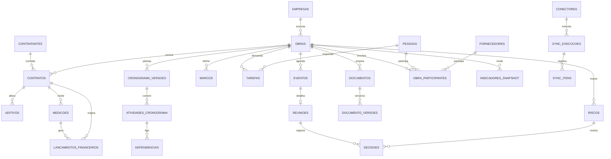

# MODELO DE DADOS PROPOSTO — Fase 0
Modelo lógico para validação. As tabelas **não** serão criadas antes da sua aprovação (Fase 1).

## 1. Convenções
- Chave primária `id uuid`; todas as tabelas de negócio têm `owner_id`, `criado_em`, `atualizado_em` (timestamptz).
- Valores monetários `numeric(14,2)` em R$; percentuais `numeric(5,2)`.
- Registros vindos de fora têm o **bloco de origem**: `fonte`, `id_externo`, `importado_em`, `atualizado_em_origem`, `hash_conteudo`, `status_sync` — com índice único `(fonte, id_externo)`.
- Exclusão lógica (`arquivado_em`) nas tabelas principais; nada é apagado fisicamente pelo sistema.

## 2. Diagrama (núcleo)

## 3. Entidades

### 3.1 Cadastros
| Tabela | Campos principais |
|---|---|
| `empresas` | razão social, nome fantasia, CNPJ — empresas pelas quais você atua (L7, C.SALLES...) |
| `contratantes` | nome, tipo (público/privado), CNPJ, órgão |
| `pessoas` | nome, função, empresa, contato, `eh_usuario` |
| `fornecedores` | razão social, CNPJ, especialidade, contato, avaliação |

### 3.2 Obras
| Tabela | Campos principais |
|---|---|
| `obras` | código, nome, empresa_id, contratante_id, endereço/cidade/UF, situação (`planejamento/andamento/paralisada/aguardando/concluida`), data_inicio, prazo_contratual_dias, data_termino_contratual, data_termino_vigente, pasta_raiz (caminho/`drive_folder_id`), observações |
| `obra_participantes` | obra_id, pessoa_id **ou** fornecedor_id, papel (gestor, fiscal, engenheiro, terceirizado), período |

> Valores e avanços **não** ficam gravados em `obras`: são calculados (views) a partir de contratos, aditivos, medições e cronograma — evita números divergentes.

### 3.3 Contratos e financeiro
| Tabela | Campos principais |
|---|---|
| `contratos` | obra_id, contratante_id, número, objeto, modalidade, data_assinatura, vigência, valor_original, regime, índice_reajuste, data_base |
| `aditivos` | contrato_id, número, tipo (`prazo/acrescimo/supressao/reajuste/reequilibrio/misto`), valor, dias, data, justificativa, situação (`em_analise/aprovado/rejeitado`) |
| `medicoes` | contrato_id, número, período_inicio/fim, valor_medido, percentual_fisico, situação (`elaborada/enviada/aprovada/glosada`), data_aprovacao |
| `lancamentos_financeiros` | contrato_id, medicao_id?, tipo (`faturamento/recebimento/previsao/glosa/retencao`), valor, data_prevista, data_efetiva, nº NF |

Separação exigida — cada valor tem origem própria:
**Contratado** = original + aditivos aprovados · **Executado** = avanço físico × valor · **Medido** = Σ medições aprovadas · **Faturado** = Σ faturamentos · **Recebido** = Σ recebimentos · **Saldo** = contratado − medido.

### 3.4 Planejamento
| Tabela | Campos principais |
|---|---|
| `cronograma_versoes` | obra_id, nome, tipo (`linha_base/vigente/reprogramacao`), data_status, arquivo_origem (.mpp), importado_em |
| `atividades_cronograma` | versao_id, uid_project, EDT/WBS, nome, nível, duração, inicio/fim planejados, inicio/fim reais, % concluído, crítica, marco |
| `dependencias` | atividade_id, predecessora_id, tipo (TI/II/TT/IT), defasagem |
| `marcos` | obra_id, nome, data_contratual, data_prevista, data_real, contratual (bool) |
| `avanco_fisico` | obra_id, data_referencia, previsto_acum, realizado_acum (base da Curva S) |

### 3.5 Gestão do dia a dia
| Tabela | Campos principais |
|---|---|
| `tarefas` | código, título, descrição, obra_id?, responsável_id, origem (`manual/trello/notion/reuniao/...`), prazo, prioridade, urgência, impacto, status, categoria, `aguardando_terceiro_id`, tarefa_pai_id + bloco de origem |
| `eventos` | título, início, fim, local, obra_id?, tarefa_id? + bloco de origem (`google_event_id`, `ical_uid`) |
| `reunioes` | evento_id?, obra_id, pauta, participantes, ata |
| `decisoes` | obra_id?, reuniao_id?, risco_id?, problema, decisão, responsável, data, resultado |
| `riscos` | obra_id, descrição, origem, categoria, probabilidade (1–5), impacto (1–5), severidade (calculada), responsável, prazo, plano_resposta, status |

### 3.6 Documentos
| Tabela | Campos principais |
|---|---|
| `documentos` | obra_id, tipo (taxonomia 01–15), título, assunto, data_documento, `drive_file_id`, caminho_local, mime, tamanho, texto_extraido (tsvector `portuguese`) |
| `documento_versoes` | documento_id, versão, `drive_revision_id`/hash, data |

### 3.7 Indicadores, integrações e auditoria
| Tabela | Uso |
|---|---|
| `indicadores_snapshot` | fotografia periódica por obra (avanço físico/financeiro, IDP/IDC, atraso em dias) para histórico e tendência |
| `conectores` | ferramenta, ativo, modo (`leitura/leitura_escrita`), configuração (json), credencial_ref (Vault), última/próxima sync |
| `sync_execucoes` | conector_id, início, fim, status, lidos, criados, atualizados, ignorados, erros |
| `sync_itens` | execucao_id, entidade, id_externo, ação, erro, payload_hash |
| `sync_conflitos` | entidade, registro_id, valor_local, valor_externo, resolução, resolvido_em |
| `auditoria` | tabela, registro_id, operação, antes (jsonb), depois (jsonb), usuário, data |
| `anexos` | vínculo polimórfico (entidade, registro_id) → documento_id |

**Total:** ~28 tabelas. Nenhuma tabela genérica do tipo "EAV"; JSON apenas para configuração e auditoria.

## 4. Views de leitura (base do dashboard e da IA)
`v_obra_resumo` (contratado, medido, saldo, % físico, % financeiro, atraso), `v_tarefas_meu_dia`, `v_vencimentos_proximos`, `v_pendencias_terceiros`, `v_curva_s`, `v_riscos_criticos`.
A IA (Fase 10) consultará **apenas essas views**, o que garante resposta com fonte e data.

## 5. Índices essenciais
`(fonte, id_externo)` único em toda tabela importada · `tarefas(status, prazo)` · `eventos(inicio)` · `medicoes(contrato_id, numero)` único · `documentos` GIN no `tsvector` · `atividades_cronograma(versao_id, uid_project)` único.
